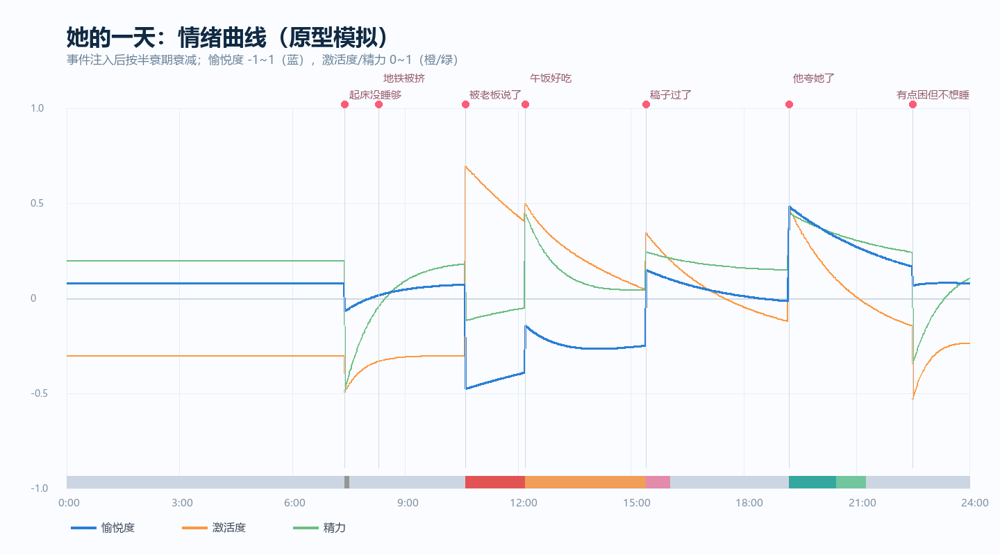

# 情绪模型设计：事件驱动 + 延续性

> 你说的是对的：**情绪不是每轮的标签，是会被事件点燃、自己慢慢灭、还会影响后面的话和后面的事的状态。**
> 这份文档把这个想法变成能跑的东西。

---

## 一、你要的东西，拆成四条

| 你的话 | 技术含义 |
|---|---|
"工作被老板说了，会产生情绪" | **事件注入情绪**（不是随机、不是模型当场编） |
"情绪是有延续性的" | **半衰期衰减**，不是说完就忘 |
"会影响后面要说的话" | 情绪 → 语气/长短/主动性 |
"还会影响后面的事情" | 情绪 → 场景选择、事项选择（生气 → 不想做饭 → 点外卖/躺着） |

---

## 二、现状：只有一个数字

```js
mood = memory.getState(qq, 'mood', 60)   // 0-100
```

问题：

```
· 只知道"心情 60 分"，不知道是烦还是累还是开心
· 没有来源（为什么 60？）
· 没有衰减（一直是 60）
· 只影响一点（mood<35 时少演温柔）
```

---

## 三、模型：三根轴 + 一个标签

### 3.1 三根轴

```
valence  愉悦度  -1 ~ 1     这感觉好不好
arousal  激活度   0 ~ 1     是躁还是静（生气高、低落低）
energy   精力     0 ~ 1     够不够撑
```

三根轴能覆盖大部分情绪，且**可衰减、可叠加**——这是一元 mood 做不到的。

### 3.2 标签由轴推出（不单独存）

```
v≤-0.35 且 a≥0.55          → 生气
v≤-0.3 且 a<0.4            → 低落
v≤-0.1 且 a≥0.5            → 烦躁
v≥0.25 且 a≥0.55           → 兴奋
v≥0.35                     → 开心
v≥0.25                     → 舒服
a≥0.6 且 v>-0.1            → 紧张
e<0.3 且 v<0.1             → 累
其余                        → 平静
```

标签只用于**提示词和日志**，判断一律用轴。

### 3.3 事件注入 + 半衰期衰减

每个事件给一个"脉冲"，之后按半衰期衰减：

```js
value(t) = impulse × 0.5 ^ (elapsed / halfLife)
```

半衰期分级（分钟）：

| 级别 | 例子 | 半衰期 |
|---|---|---|
minor | 地铁被挤、起床没睡够 | 45 |
medium | 稿子过了、被他夸 | 150 |
major | 被老板当众说 | 420 |

**关键细节：激活度比愉悦度衰减快**（气头过得快，底色留得久）。

```js
a_halfLife = halfLife × 0.45
e_halfLife = halfLife × 0.8
```

---

## 四、模拟验证：一天的情绪曲线

用 7 个事件跑 24 小时（`scripts/affect-sim.mjs`）：

```
07:24  起床没睡够     -0.15
08:18  地铁被挤       -0.20
10:36  被老板说了     -0.55   ← 重大事件
12:12  午饭好吃       +0.25
15:24  稿子过了       +0.40
19:12  他夸她了       +0.50
22:30  困但不想睡     -0.10
```



关键读数：

```
10:36 被说 → 愉悦度 -0.48，激活度 0.85，标签"生气"
11:30 仍是生气（-0.43 / 0.76）        ← 延续性
12:12 午饭只拉回一点（-0.14 / 0.75）   ← 好消息盖不住坏消息
17:00 才回到平静（-0.05 / 0.53）       ← 气消了，但用了 6 小时
19:12 被他夸 → 兴奋（0.48 / 0.74）
```

一天的情绪占比：

```
平静 68% · 烦躁 13% · 生气 7% · 兴奋 5% · 舒服 3% · 紧张 3% · 累 0.6%
```

**这个分布是合理的**：大部分时间平静，偶尔被点燃，不会一天到晚在生气。

---

## 五、情绪从哪来

### 5.1 场景事件（主力）

场景层的事项带 `moodImpact`：

```json
{
  "text": "被叫去办公室",
  "kind": "work",
  "moodImpact": { "v": -0.55, "a": 0.5, "e": -0.15, "size": "major" }
}
```

事项进入 `done` 的**那一刻**触发注入——"被叫去办公室"这件事做完了，情绪才开始。

### 5.2 用户互动（次要，但很真实）

```
被夸      → v+0.3 ~ +0.5
被冷落    → v-0.2（回复间隔长也一样）
被凶      → v-0.4, a+0.4
被安慰    → v+0.3，且对当前负面情绪"加速衰减"
```

**"被安慰"要特殊处理**：不是加一个正向脉冲，而是**缩短现有负面事件的剩余寿命**——他哄她，气真会消得快。

### 5.3 生理基线

```
没睡够 → energy 低，且 valence 基线略降
饿了   → 烦躁概率上升
深夜   → energy 自然下降
```

由场景层的时间带给出（night 带 energy -0.1），不单独建模。

---

## 六、情绪影响什么

### 6.1 影响"怎么说"（生成层）

```
生气（v-0.5 a+0.5）  → 短句、少问句、带刺、不主动撒娇
低落（v-0.4 a-0.2）  → 慢、话少、容易自我否定
兴奋（v+0.5 a+0.6）  → 连发、感叹号、追问
累  （e 0.25）       → 极短、敷衍但不说重话
```

写法：不直接写"你在生气"，而是给**风格提示**：

```
【此刻状态】不太高兴，别装没事，但也不用把气撒他身上（回应短一些）
```

### 6.2 影响"做什么"（裁决层）

```
生气 + 他敷衍        → advance 概率↑（不想理）
低落 + 他关心        → engage/粘人↑
兴奋 + 任何话题      → 话多，sticky↑
累                   → 一律短，且不主动
```

### 6.3 影响"后面发生什么"（场景层）—— 你要的那条

情绪高唤醒负面 → 场景加权变化：

```
生气（a≥0.6）   → 更容易选 "加班/一个人待着/下楼走走"
低落（v≤-0.3）  → 更容易选 "躺着/点外卖/吃甜的"
兴奋            → 更容易选 "跟人说话/刷购物/收拾屋子"
```

实现：`选场景时给候选加 moodWeight`，不改场景池本身。

### 6.4 影响"要不要主动"（主动消息）

```
兴奋 → 更可能主动分享（"你猜怎么着"）
低落 → 更可能求陪（"在吗"），但不会撒娇
生气 → 可能主动吐槽，但**不会**说"我想你"
```

---

## 七、防止失控的四条护栏

| 风险 | 护栏 |
|---|---|
一天到晚在生气 | 情绪上下限 + 同一事件不重复注入 + 睡眠重置 |
情绪每轮翻转 | 情绪**只由事件改**，不由生成结果改（避免自激） |
一直低落 | 每天起床做一次"基线回归"（衰减 60%） |
被哄还记仇 | "被安慰"缩短负面事件寿命，最多提前 60% |

---

## 八、存储

```sql
-- 当前状态（每用户一行）
CREATE TABLE affect_state (
  qq TEXT PRIMARY KEY,
  v REAL, a REAL, e REAL,
  label TEXT,
  updated_at INTEGER
);

-- 情绪事件（有因果才可解释）
CREATE TABLE affect_events (
  id INTEGER PRIMARY KEY AUTOINCREMENT,
  qq TEXT NOT NULL,
  source TEXT,          -- scene | user | system
  what TEXT,            -- 被老板说了
  v REAL, a REAL, e REAL,
  half_life_min INTEGER,
  at INTEGER,
  faded_at INTEGER      -- 衰减到可忽略的时间
);
```

`affect_events` 的价值：一周后她可以说"你上次惹我生气那事我还没忘"——有据可查。

---

## 九、和场景层的关系

```
场景层 ──产生事项(moodImpact)──→ 情绪层
情绪层 ──moodWeight──────────→ 场景层（选场景时加权）
```

**顺序**：先做场景层（产出事件），再做情绪层（消费事件）。
如果反过来，情绪层没有事件可吃，只能靠模型瞎编——那又回到"地板有点凉"。

---

## 十、实施步骤

| 步骤 | 内容 | 工时 |
|---|---|---|
1 | `affect.mjs`：注入/衰减/标签/提示词（纯函数 + 单测） | 0.5 天 |
2 | 场景事项加 `moodImpact`，done 时注入 | 0.2 天 |
3 | 生成层接 `toneHint`（语气提示） | 0.2 天 |
4 | 裁决层接 `actBias`（3 条规则） | 0.2 天 |
5 | 场景选择接 `moodWeight` | 0.2 天 |
6 | 互动注入（被夸/被凶/被安慰） | 0.3 天 |
7 | 影子观察 1 天 | — |

**约 1.5 天**，在场景层之后做。

---

## 十一、验证

```
① 单测：半衰期数学（注入后 45/150/420 分钟剩一半）
② 模拟：已跑，一天曲线合理（本文第四节）
③ 影子日志：每轮记录 "v/a/e + 标签 + 触发事件"
④ 一致性抽查：抽 20 条回复，看她的话和情绪是否对得上
```

---

## 十二、用户情绪模型（她对"他"的判断）

> 情绪层不只管她自己，还要**估计他现在的状态、以及接下来会怎样**。
> 感知层只读"这一句"，情绪层要维护"这个人"。

### 12.1 为什么不能只靠感知层

```
感知层：每轮独立 → 翻转率 35.4%（实测）
感知层：只有类别 → 没有强度、没有趋势
感知层：判不准就不判 → 难过 0%、生气 0%（实测 246 条）
```

所以要有第二层：把零散的句子级判断，**累积成一个人的状态**。

### 12.2 输入：三类信号

```js
// ① 句子级（感知层给）
{ tone: { label: '敷衍', intensity: 0.7 }, event: { kind: 'ignore' } }

// ② 行为信号（不用模型，直接算）
{
  replyGapMin: 42,        // 距上一条回复多久
  msgLen: 3,              // 这条多短
  isShortStreak: 3,       // 连续几条 < 5 字
  topicSwitch: false,     // 有没有换话题
  hasEmoji: true,
  lateNight: false
}

// ③ 历史（情绪层自己存）
{
  v: -0.3, a: 0.3, confidence: 0.55, trend: -0.08, updatedAt: ...
}
```

### 12.3 状态与更新

```js
UAffect = {
  v: -1..1,          // 估计他此刻的愉悦度
  a: 0..1,           // 激活度（躁不躁）
  confidence: 0..1,  // 对这个估计有多确定
  trend: -1..1,      // 最近 30 分钟的方向（变好/变坏）
  updatedAt: 时间戳
}
```

更新公式（加权滑动 + 衰减）：

```
新观测 obs = tone 映射成 (v, a)，权重 = intensity × 0.6
行为信号修正：连续短回复 → v 下调 0.15；回复变慢 → confidence 下调
UAffect.v = lerp(旧值衰减后, obs.v, 权重)
confidence 随轮数累积，超过 12 小时未说话则重置为 0.3
```

### 12.4 预测：短期 + 中期

| 预测 | 方法 | 用途 |
|---|---|---|
短期（下一轮） | `v + trend × 1`，外推 | 判断"该哄还是要退" |
中期（今天） | 过去 3 小时的滑动平均 | 决定主动消息要不要发 |
风险（升级） | 连续 3 轮负面 + 强度在涨 + 消息在变短 | 她收敛、不贫 |

**规则优于模型**：这三条都能用规则算清楚，不需要再调一次大模型。

### 12.5 输出给下游

```js
{
  he: { v: -0.4, a: 0.35, confidence: 0.7, trend: -0.1, state: '低落' },
  empathy: 0.8,     // 该共情到什么程度
  caution: 0.6,     // 收敛度：别开玩笑、别贫
  allowProactive: false  // 他状态差时别主动打扰
}
```

生成层只看到三个数字，不需要理解整套模型：

```
【他的状态】不太好，别开玩笑，接住就行（共情 0.8）
```

### 12.6 情绪传染：他影响她

```
他明显负面 → 她的情绪轻微同向（权重 0.15~0.3）
他明显开心 → 她的 mood 上浮（权重 0.2）
```

依据：文本交流中确实存在情绪传染（Cheshin 等，2011；即使没有语气和表情）。
但权重必须小——**她不能他一不高兴就崩**。

这条也解释了"她为什么突然安静"：不是被指令控制，是被他影响。

### 12.7 边界（防止瞎猜）

```
· confidence < 0.4 时不做任何动作（不共情、不收敛、不预测）
· 只判断"聊天状态"，不做心理诊断
· 猜错要能纠：他下一句明显开心 → 立刻修正，不坚持
· 连续两次预测被推翻 → 清空重来
```

### 12.8 验证方法

```
① 回放 246 条历史：用"下一轮他是否继续聊/变得更短"做弱标签，
   看 v/trend 的方向是否对得上（目标：方向准确率 > 65%）
② 单测：连续 5 条敷衍 → 估计值下滑且 confidence 上升
③ 影子日志：每轮记 he.v / confidence / 预测，人工抽查 20 条
```

引用：

- Cheshin, A. et al. (2011). Anger and happiness in virtual teams — 文本交流中的情绪传染 — [ScienceDirect](https://www.sciencedirect.com/science/article/abs/pii/S0749597811000756)
- 在线聊天日志中的状态推断 — [Mining the Minds of Customers from Online Chat Logs](https://ar5iv.labs.arxiv.org/html/1510.01801)

---

## 附：和现有 mood 的关系

```
现在：mood 0-100（单一数字）
之后：mood 保留，由 valence 映射（mood = (v+1)×50）
      旧代码读 mood 的地方不用改，但以后逐步切到三轴
```
